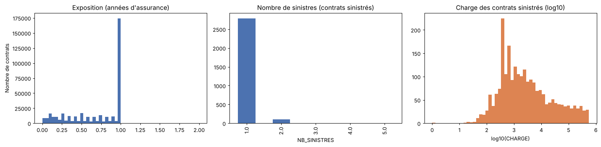

# 🔥 Prime d'assurance et tarification – Risque incendie

Projet de **tarification actuarielle** réalisé dans le cadre d'un *data challenge*. L'objectif est de prédire la **charge sinistre incendie** de contrats d'assurance professionnels (multirisque entreprise) à partir de ~370 caractéristiques du contrat, du bâtiment et de l'activité.

## 🎯 Problématique

La charge d'un contrat se décompose selon l'approche actuarielle classique **fréquence × coût moyen** :

```
CHARGE = FREQ × CM × ANNEE_ASSURANCE
         │      │     └── exposition (durée assurée, en années)
         │      └──────── coût moyen d'un sinistre
         └─────────────── fréquence de sinistres (nombre / an)
```

**Métrique** : RMSE sur `CHARGE`.

**Difficultés** :
- moins de **1 % des contrats** sont sinistrés, donc la cible vaut 0 dans plus de 99 % des cas ;
- les coûts sont **très asymétriques** : quelques sinistres graves pèsent lourd dans la charge totale et dans le RMSE ;
- **374 variables**, dont 280 catégorielles, peu documentées (`CARACT`, `KAPITAL`, `DEROG`, …) ;
- l'exposition est variable d'un contrat à l'autre et doit être prise en compte comme poids, pas comme variable explicative.

## 🧠 Démarche

| Étape | Contenu |
|---|---|
| **Exploration** | Taux de sinistralité, distribution de l'exposition, du nombre de sinistres et des coûts |
| **Préparation** | Typage mémoire (5 Go → < 1 Go), *count encoding* des catégorielles, retrait des colonnes constantes |
| **Validation** | Un jeu de validation commun (20 %, stratifié sur la présence d'un sinistre) pour comparer tous les modèles à armes égales, plus un modèle de référence (prime pure moyenne) |
| **Modélisation** | Fréquence en loi **Poisson** pondérée par l'exposition, coût moyen en loi **Gamma** sur les seuls contrats sinistrés, pondéré par le nombre de sinistres |
| **Modèles** | GLM (Poisson × Gamma) · HistGradientBoosting · LightGBM · XGBoost Tweedie (prime pure directe) |
| **Soumission** | Réentraînement du meilleur modèle sur 100 % du train, puis fichier `ID, FREQ, CM, ANNEE_ASSURANCE, CHARGE` |

## 📊 Résultats

### Les données en chiffres

| | |
|---|---|
| Contrats / exposition | 383 610 contrats · 269 124 années assurées |
| Contrats sinistrés | 2 894 (**0,75 %**) |
| Fréquence | 11,2 sinistres pour 1 000 années |
| Coût moyen d'un sinistre | 23 763 |
| Prime pure moyenne | 265 par an |
| Concentration | Les 10 % de sinistres les plus coûteux = **79 % de la charge** |



### Comparaison des modèles (jeu de validation commun, 76 722 contrats)

| Modèle | RMSE | Gini normalisé |
|---|---:|---:|
| Référence : prime pure moyenne × exposition | 7 254 | 0,03 |
| **GLM Poisson × Gamma** | **7 251** | **0,58** |
| HistGradientBoosting Poisson × Gamma | 7 255 | 0,49 |
| LightGBM Poisson × Gamma | *voir notebook* | *voir notebook* |
| XGBoost Tweedie (prime pure) | *voir notebook* | *voir notebook* |

### Ce qu'il faut retenir

- **Le RMSE ne départage presque pas les modèles.** Il est dominé par une poignée de sinistres graves, si bien qu'un tarif constant obtient un score très proche des meilleurs modèles.
- **Le Gini révèle le vrai apport de la modélisation** : les modèles classent bien mieux les contrats selon leur risque (0,58 contre 0,03). C'est ce qui permet de tarifer plus juste.
- **Un équilibrage est indispensable** : avec un lien log, les modèles Gamma sous-estiment le coût moyen d'une distribution à queue lourde. Un coefficient global recale la charge prédite sur la charge observée.
- **La fréquence est bien calibrée** par tous les modèles : 602 sinistres prédits pour 592 observés en validation.

## 📁 Structure du dépôt

```
├── notebooks/
│   └── tarification_incendie.ipynb   # Notebook principal (exploration → soumission)
├── data/
│   ├── Dataset1.zip                  # train_output (cibles) + test_input (95 852 contrats)
│   ├── Dataset2.zip                  # train_input (383 610 contrats × 374 variables)
│   └── dictionnaire_variables.xlsx   # Libellé de chaque variable
├── images/                           # Figures du README
├── outputs/                          # Créé à l'exécution (submission.csv)
├── requirements.txt
└── README.md
```

Le notebook lit les CSV **directement dans les archives** : il n'y a rien à décompresser.

## ▶️ Lancer le projet

```bash
git clone https://github.com/christsodji/Prime-d-assurance-et-tarification.git
cd Prime-d-assurance-et-tarification
pip install -r requirements.txt
jupyter notebook notebooks/tarification_incendie.ipynb
```

Exécution complète : environ 15 à 30 minutes selon la machine, avec 8 Go de RAM recommandés.

## 🛠️ Compétences

`Python` · `pandas` · `scikit-learn` · `LightGBM` · `XGBoost` · GLM (Poisson, Gamma, Tweedie) · actuariat non-vie (fréquence / coût moyen, exposition, prime pure) · gestion de données volumineuses

---

👤 **Christ Sodji** · [GitHub](https://github.com/christsodji) · Voir aussi : [Credit-scoring](https://github.com/christsodji/Credit-scoring)
